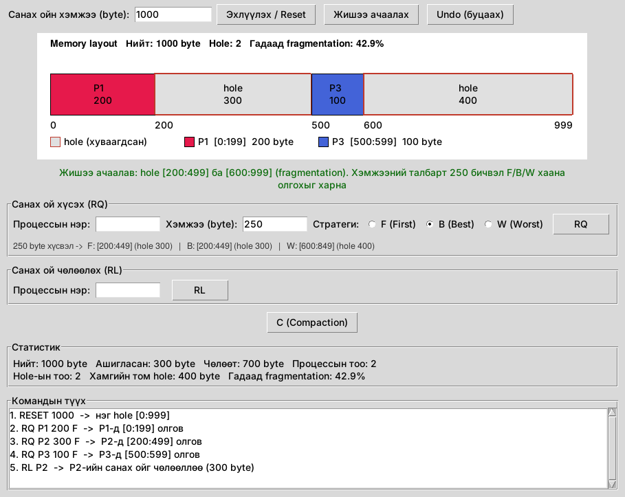
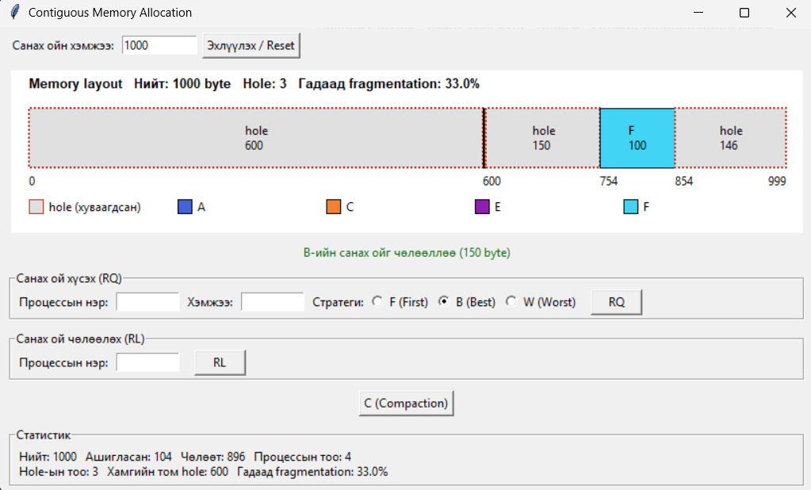
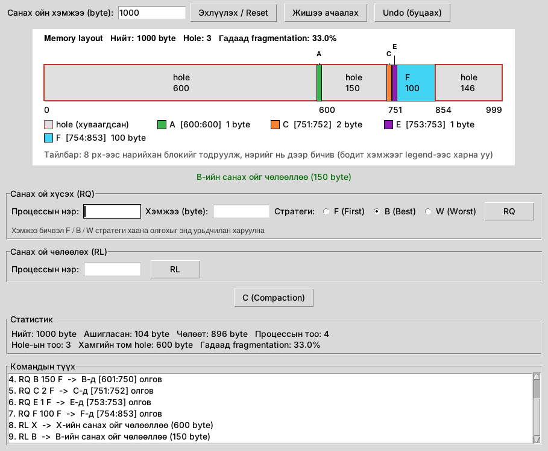

# V-1-14: Contiguous Memory Allocation

F.CSM302 Үйлдлийн систем, Бие даалт 1 ба 2 (**Final, v2.0**). Хуваарилалтын код: **V-1-14**.

## Зорилго

Operating System Concepts (10th ed., 2018), 9-р бүлгийн Programming Project болох **Contiguous Memory Allocation**-ийг хэрэгжүүлсэн.
MAX хэмжээтэй тасралтгүй санах ойн мужид (хаяг 0…MAX−1) процессуудад **First-fit (F)**, **Best-fit (B)**, **Worst-fit (W)** стратегиар хэсэг олгох,
чөлөөлөх, hole-уудыг шахах (compaction) болон байдлыг тайлагнах загварчлалын програм. Санах ой бодит биш, тоогоор бодогдоно.
Хоёр интерфейстэй: **CLI** (`allocator>` prompt) ба **GUI** (tkinter, **Memory layout** зурагтай). Хоёулаа нэг `allocator.py`-г ашиглана.

## Quick Start

Шаардлага: Python 3.10 эсвэл түүнээс дээш. Нэмэлт сан хэрэггүй (зөвхөн стандарт сан).
Windows-ийн Python суулгагч tkinter-ийг агуулдаг. Linux (Debian/Ubuntu) дээр GUI ажиллахгүй бол: `sudo apt install python3-tk`

```bash
git clone https://github.com/orgilSt1/OS-biydaalt.git
cd OS-biydaalt

# CLI (1000 нь санах ойн хэмжээ, byte)
python src/cli.py 1000                       # Linux: python3 src/cli.py 1000

# CLI, командыг файлаас уншуулах (Windows cmd)
python src\cli.py 1000 < examples\example1.txt
#   Linux: python3 src/cli.py 1000 < examples/example1.txt

# GUI
python src/gui.py                            # Linux: python3 src/gui.py

# Бүх автомат тест (төслийн үндсэн фолдероос)
python -m unittest discover tests            # Linux: python3 -m unittest discover tests
                                             # хүлээгдэх: Ran 76 tests ... OK
                                             # tkinter/дэлгэцгүй орчинд: OK (skipped=10), GUI-ийн 10 тест алгасагдана
                                             # Linux, дэлгэцгүй: xvfb-run -a python3 -m unittest discover tests

# Стратегийн харьцуулалтын туршилт (~25 секунд, experiments/results.csv, results.md)
python experiments/strategy_experiment.py    # Linux: python3 experiments/strategy_experiment.py
```

## Командууд

| Команд | Үүрэг |
|---|---|
| `RQ <нэр> <хэмжээ> <F\|B\|W>` | Санах ой хүсэх (нэрэнд зай байхгүй, хэмжээ 0-ээс их бүхэл тоо) |
| `RL <нэр>` | Санах ой чөлөөлөх, зэргэлдээ hole нэгдэнэ |
| `C` | Compaction: процессуудыг эхлэл рүү шахаж hole-уудыг нэг болгоно |
| `STAT` | Хуваарилагдсан ба чөлөөт мужийг харуулах |
| `X` | Гарах |

Хэмжээ, хаяг бүгд **byte**-аар. Хаяг оролцуулсан (inclusive): 200 byte-ийн блок 0-ээс эхэлбэл `[0:199]`.
Команд том/жижиг үсгээр ялгагдахгүй, процессын нэр ялгагдана.

Жишээ:

```
allocator> RQ P0 40000 W
P0-д [0:39999] олгов
allocator> STAT
Addresses [0:39999] Process P0
Addresses [40000:1048575] Unused
```

## Memory layout дүрслэл (GUI)

Блок бүрийн өргөн хэмжээтэй пропорциональ. Өнгөт блок = процесс (нэр, хэмжээ), саарал = hole.
Hole-уудын **улаан тасархай** хүрээ = нэгээс олон hole (гадаад fragmentation), **саарал тасархай** хүрээ = нэг тасралтгүй чөлөөт зай.
Блокийн доор эхлэх хаяг, гарчигт нийт хэмжээ, hole-ын тоо, fragmentation (%) гарна. Доор нь legend (`P1  [0:199]  200 byte`) байна.

**v2.0-д нэмсэн:** анхдагч 1000 byte-аар шууд эхлэх; **Жишээ ачаалах** товч; **Undo**; **командын түүх** (алдаа улаан); RQ-ийн хэмжээ бичихэд F/B/W хаана олгохыг **урьдчилан харах**; 1–2 byte-ийн нарийхан блокийг (<8 px) тодруулж нэрийг нь бичих; оролтыг хатуу шалгах (`1_0` → алдаа).



| Нарийхан блок: БД1 (v1.0) | БД2 (v2.0) |
|---|---|
|  |  |

Screenshot-ууд бодит программаас авсан (v1.0: Windows 11; v2.0: Ubuntu 24.04, Python 3.12, Tk 8.6).

## Бүтэц

| Зам | Агуулга |
|---|---|
| `src/allocator.py` | Бүх логик: `Block`, `Allocator` (request, release, compact, get_stats, preview, snapshot/restore), `parse_int`. `print`/`input` байхгүй |
| `src/cli.py` | Командын мөрийн интерфейс |
| `src/gui.py`, `src/gui_canvas.py` | Цонх, товчлуур ба Memory layout зурах хэсэг |
| `tests/` | `test_allocator.py` (34), `test_cli.py` (20), `test_gui_canvas.py` (12, дэлгэцгүй), `test_gui.py` (10, дэлгэц хэрэгтэй) |
| `examples/` | `example1…5.txt` ба `.expected.txt` хос; тайлбар `examples/README.md` |
| `experiments/` | `strategy_experiment.py`: F/B/W харьцуулалт, хурд; үр дүн `results.csv`, `results.md` |
| `docs/` | `V-1-14_Final_Report.pdf`, `V-1-14_Poster.pdf`, `V-1-14_Manual.pdf`, `V-1-14_BD1_Report.pdf`, `screenshots/`, `images/` |

## Туршилт

- **Автомат тест:** 76 тест, бүгд давсан (Ubuntu 24.04, Python 3.12.3, Xvfb дээр GUI-ийн тесттэй). Дэлгэцгүй орчинд (Python 3.11, 3.12, 3.13) 66 OK + 10 алгасагдсан. БД1-ийн 39 тест шинэ кодод хэвээр давна (regression). v2.0-ийн GUI-г багийн гишүүд Windows 11 дээр гараар шалгасан (автомат тест Windows дээр давтагдаагүй).
- **Жишээ файл:** 5 файлын гаралтыг `.expected.txt`-тэй харьцуулна: `python src\cli.py 1000 < examples\example1.txt > out.txt` ба `fc out.txt examples\example1.expected.txt` (Linux: `python3 src/cli.py ...` ба `diff`).
- **Номын жишээ:** 550 + 375 + 1900 + 4500 KB-ийн дөрвөн hole compaction-ий дараа нэг 7325 KB hole болдог (`test_book_compaction_example`).
- **Санамсаргүй тест:** seed-тэй санамсаргүй RQ/RL/C дарааллын дараа бүтцийн инвариант ба стратеги бүрийн сонголтыг бие даасан тооцоотой тулгана (`TestRandomizedInvariants`).
- **Туршилт (experiments/):** 100 000 byte, 2000 хүсэлт, 50 seed дээр амжилтгүй хүсэлт: First-fit 0.21%, Best-fit 0.09%, Worst-fit 2.81%; дундаж fragmentation 60.0% / 55.9% / 88.8%.
- Дэлгэрэнгүй: `docs/V-1-14_Final_Report.pdf` (БД2), `docs/V-1-14_BD1_Report.pdf`. Алхам алхмаар заавар: `docs/V-1-14_Manual.pdf`.

## БД2: шүүмжийн нөхцөл

V-1-14 баг шүүмжлэгчээр хуваарилагдаагүй тул албан ёсны Review PDF ирээгүй. Багийн дотоод аудит (self-review)-ийг Final Report-ын 4-р хэсэгт Critical/Major/Minor/Suggestion ангиллаар, шийдвэр ба нотолгоотой нь бүртгэсэн.

## Мэдэгдэж буй хязгаарлалт

- Нарийхан блокийн тэмдэг 8 px тул бодит байрлалаас хэдэн px зөрж болно; яг хаяг, хэмжээ legend, STAT-д.
- 12-оос олон зэрэг амьд процесст өнгө давтагдана. Undo нь оролтын талбарын текстийг буцаахгүй.
- Python 3.10, macOS дээр шалгаагүй. v2.0-ийн GUI-г багийн гишүүд Windows 11 дээр гараар шалгасан; автомат тест Windows дээр давтагдаагүй.
- Хүрэлцэхгүй хүсэлтийг хүлээлгийн дараалалд тавихгүй, татгалзана (номын шаардлагын дагуу).

## Баг

| № | Оюутны код | Нэр |
|---|---|---|
| 1 | B241910016 | Я.Мөнх-Оргил |
| 2 | B232290038 | Н.Гантогтох |
| 3 | B222270065 | Э.Эрдэнэбат |
| 4 | B241910045 | Б.Баасандорж |
| 5 | B242270080 | Э.Халиунаа |

## AI болон бэлэн материалын ашиглалт

- Суурь код, тестийн араг ясыг (src/, tests/) болон Report, Manual, README-ийн эх бичвэрийг Claude (Anthropic)-ийн тусламжтай бэлтгэж, гишүүд ажиллуулж, шалгаж, шаардлагатай хэсгийг засварласан
- БД2: self-review, код засвар, шинэ тест, `experiments/`, Final Report, Poster, Manual-ийн шинэчлэлтийг мөн Claude-ийн тусламжтай бэлтгэсэн; тоо нь тест/скриптийн бодит гаралт, screenshot нь жинхэнэ программаас
- Гадны сан ашиглаагүй (зөвхөн Python стандарт сан).

## Release

Хувилбар v2.0 (Final, БД2): https://github.com/orgilSt1/OS-biydaalt/releases/tag/v2.0

Хувилбар v1.0 (БД1): https://github.com/orgilSt1/OS-biydaalt/releases/tag/v1.0
